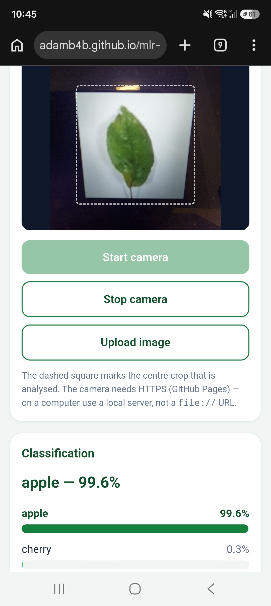

# REVIEW.md — Task 2

Reviewed page: <https://adamb4b.github.io/mlr-ex08/>
Reviewed on: `TODO` — phone model, Android, Chrome, 12 November 2026. Model `leaf_model.onnx`
from the notebook, unmodified.

## 1. It runs on my phone

| What I checked | What I saw |
| --- | --- |
| Phone and browser | The app opens in the browser |
| Did the page load, did the camera ask for permission? | The Page loads and it asks for camera permission |
| Did it classify the live picture, and how fast? | It classify the live picture almost instantly |
| Which class won on a real leaf, and did it change when I moved the phone? | It changed for a little bit but after it it stabilaze |
| Did I have to fix anything for it to work? | No, everything worked properly |

The screenshot is the published address in the address bar of the phone, the camera picture of a
leaf in the middle with the dashed square over it, and the classification under it: **apple 99.6 %
/ cherry 0.3 %**. Under the bars the page prints how long the last inference took on that device —
`TODO`: write the number you see there, it is the answer to "how fast" above.

## 2. The same numbers as the notebook

I uploaded `check_image.jpg` with the **Upload image** button and read the four probabilities off
the page. They are the numbers from `check_expected.json`, which the notebook wrote when it saved
the model.

| Class | Notebook (`check_expected.json`) | My page | Difference |
| --- | --- | --- | --- |
| apple | 0.983 | 0.983 | none |
| cherry | 0.017 | 0.017 | none |
| chestnut | 0.000 | 0.000 | none |
| maple | 0.000 | 0.000 | none |

They agree to three decimals — to four as well. The same check is built into the page: opening
`https://adamb4b.github.io/mlr-ex08/?selftest=1` runs `check_image.jpg` through the normal
upload path and prints `logits`, `probabilities`, `tensorShape` and the comparison with
`check_expected.json` with an overall `pass` flag. The tensor the page builds is
**`1x3x96x96`**, which is what the model expects, so the agreement is not an accident of the image
being easy — the preprocessing produces the same numbers as the notebook.

## 3. The preprocessing matches my model

From `model_info.json`: input size **96**, mean **[0.485, 0.456, 0.406]**, std
**[0.229, 0.224, 0.225]**, classes in this order **apple, cherry, chestnut, maple**. The page never
hardcodes any of this; it reads the file at line 451 and uses `info.input_size`, `info.mean[c]`,
`info.std[c]` and `info.classes`.

All of it is in one function, **`preprocess()` at lines 304–334** of `index.html`, and the same
function serves the live camera and an uploaded photo (`classify()`, line 347, is the only caller).

| Step | Where it is in `index.html` | Does it match the notebook? |
| --- | --- | --- |
| central square crop of the frame | lines 313–315: `side = Math.min(sourceWidth, sourceHeight)`, `sx` and `sy` put the crop in the middle | yes — the images were already centre-cropped to a square when the ZIP was built |
| resize to 96 × 96 | line 316: `workCtx.drawImage(source, sx, sy, side, side, 0, 0, size, size)` — crop and resize in one call; `size` is `info.input_size`, line 305 | yes, `transforms.Resize`/the dataset's 96 × 96 |
| pixels read out, alpha dropped | line 319: `getImageData(0, 0, size, size)`, an RGBA array; line 330 reads `rgba[i * 4 + c]`, so the 4th byte (alpha) is never used | yes, `ToTensor()` works on RGB |
| divided by 255 (`ToTensor`) | line 330: `rgba[i * 4 + c] / 255` | yes, `transforms.ToTensor()` |
| standardized with mean and std (`Normalize`) | line 330: `( … / 255 − mean) / std`, with `mean`/`std` taken per channel from `info` at lines 326–327 | yes, `transforms.Normalize(mean, std)` with the same ImageNet numbers |
| channel order in the tensor (CHW, shape `[1,3,96,96]`) | lines 323–332: `offset = c * area`, written to `data[offset + i]`, so all reds first, then green, then blue — `c*96*96 + y*96 + x`; line 333 wraps it as `new ort.Tensor('float32', data, [1, 3, size, size])` | yes, PyTorch CHW, `ToTensor` also puts channels first |
| softmax over the raw logits | lines 337–342 `softmax()`, called at line 354 after `session.run` returns the raw `logits` | yes — the model has no softmax layer because `nn.CrossEntropyLoss` applies it during training |

The order is the same as the notebook's `transforms.Compose([ToTensor(), Normalize(mean, std)])`:
crop, resize, bytes → 0–1 by 255, then subtract mean and divide by std **per channel**, then
channels first. The division by 255 and the standardization happen in the same expression, in the
same order, on line 330. The channel loop (`for c`, line 325) is outside the pixel loop, which is
what makes the layout CHW instead of HWC.

## 4. Nothing leaves the phone

The page loads these URLs and nothing else. I checked with DevTools → Network on the desktop
version of the same address, and with the same page opened on the phone.

| URL the page loads | Why it is needed | Does it receive my image? |
| --- | --- | --- |
| `https://cdn.jsdelivr.net/npm/onnxruntime-web@1.31.1/dist/ort.min.js` (line 15) | the library that runs the network in the browser | no — it is a plain script file |
| `https://cdn.jsdelivr.net/npm/onnxruntime-web@1.31.1/dist/` (`ORT_DIST`, line 254, set at line 448) | the WebAssembly binary of the same library, loaded by `ort` when the session is created | no |
| `https://cdn.jsdelivr.net/npm/qrcode-generator@1.4.4/qrcode.min.js` (line 16) | draws the QR code at the bottom as inline SVG, so no external QR service is needed | no |
| `./model_info.json` (line 256, fetched at line 451) | classes, input size, mean, std | no — same site, and it only sends a GET |
| `./leaf_model.onnx` (line 255, fetched at line 460 with a progress bar) | the model, ~6.2 MB, downloaded **to** the phone | no — the response comes the other way |
| `./check_expected.json` | only when the address has `?selftest=1` (line 677), to compare with | no |

No request carries image data. A camera frame goes `video` → `drawImage` into an offscreen canvas
(line 316) → a `Float32Array` (line 324) → an `ort.Tensor` (line 333) → `session.run()`
(line 352), and all of that is in the page's own memory. The session is created with
`executionProviders: ['wasm']` (line 463), so the maths is done by WebAssembly in the phone's
browser: the model is downloaded to the phone and run there, and the phone never sends a picture
to anybody. The only two places an image could leave are the two CDNs above, and they are asked
for fixed library files, not for anything containing my picture.

## What the agent had to fix

* On the phone, nothing — the page worked the first time it was opened from the Pages address, so
  there was no fix to make to the camera code.
* What did have to be fixed was around the page: the address `APP_URL` in `index.html` (line 252)
  was empty, so the QR code only came out right when the page was opened from GitHub Pages and not
  from the local file; it is now set to the published address. The published address itself had to
  be put into `README.md` after Pages was switched on, and the collaborator for the teacher was
  missing.
* One thing that looks like a bug and is not: the page runs the model on **one** thread
  (`ort.env.wasm.numThreads = 1`, line 447). GitHub Pages sends no COOP/COEP headers, so the page
  is not `crossOriginIsolated` and multi-threaded WebAssembly would fail there.
